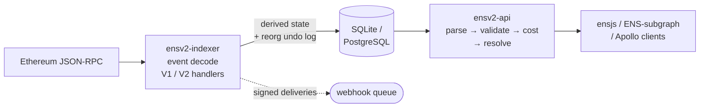

<p align="center">
  
</p>

<h1 align="center">Zigens</h1>

<p align="center">
  A complete ENS index — V1 and V2 — behind a subgraph-compatible GraphQL API.<br>
  Two static binaries, 59 MiB resident on mainnet.
</p>

<p align="center">
  <a href="https://github.com/mdtanrikulu/zigens/actions/workflows/ci.yml"></a>
  
  
  
</p>

<p align="center">
  <a href="https://mainnet-graphql.ens.dev"><b>Live playground</b></a> ·
  <a href="#quick-start">Quick start</a> ·
  <a href="#performance">Performance</a> ·
  <a href="#configuration">Configuration</a>
</p>

---

Zigens follows ENS contract events, derives the current state of names, registrations, resolver
records, roles and accounts, survives chain reorganizations, and serves everything over a GraphQL
endpoint that works with existing ensjs / ENS-subgraph / Apollo clients. It is written in Zig and
runs on SQLite or PostgreSQL.

## Quick start

Requires **Zig 0.16.0+** and an Ethereum JSON-RPC endpoint.

```bash
git clone https://github.com/mdtanrikulu/zigens.git && cd zigens
zig build                      # all binaries → zig-out/bin/
cp .env.example .env           # set RPC_URL and NETWORK

./zig-out/bin/ensv2-indexer    # index (resumes from the last synced block)
./zig-out/bin/ensv2-api        # serve → http://localhost:8080/graphql
```

`GET /graphql` opens the GraphiQL playground; `POST /graphql` runs queries. List queries return
**normalized, reachable** names by default — pass `includeUnnormalized: true` to include the rest.

On macOS, prefix builds with `PKG_CONFIG_PATH="/opt/homebrew/opt/sqlite/lib/pkgconfig:$PKG_CONFIG_PATH"`
so SQLite links. For TLS PostgreSQL (managed / Neon), build with `zig build -Dpg-tls=true`.

### Binaries

| Binary | Description |
|--------|-------------|
| `ensv2-indexer` | Combined V1 + V2 indexer (can also serve the API) |
| `ensv2-indexer-v1` | V1-only indexer |
| `ensv2-indexer-v2` | V2-only indexer |
| `ensv2-api` | Standalone GraphQL API server (read-only) |
| `rainbow-backfill` | Resolve unknown `[0x…]` labels from the rainbow table |
| `test-db-reader` | Inspect / dump a database for debugging |

## Features

### Indexing
- Indexes **ENS V1 (legacy registry, registrar, name wrapper)** and **ENS V2 (permissioned
  registry)** side by side in one database.
- Tracks registrations, ownership and transfers, resolver records (addresses, text, contenthash,
  DNS, ABI, pubkey…), wrapper state and fuses, access-control roles, and reverse records.
- Discovers new subregistries and resolvers automatically from on-chain events.
- Recovers human-readable labels via a rainbow table, with a backfill tool for the rest.
- Reorg-safe: reorganizations are detected by block hash and undone from a capture log that
  reverses in-place field updates (owner, resolver, expiry, subregistry, parent) as well as
  inserts, over a 1000-block window. With `FINALITY_ENABLED` the indexer also follows the chain's
  `safe` and `finalized` blocks and reports how far the indexed head trails each.

### GraphQL API
- Subgraph-compatible schema — a drop-in for many existing ENS clients.
- Rich filtering, including `and` / `or` boolean conditions. List queries return only normalized,
  reachable names by default.
- Offset (`first` / `skip`) and Relay cursor pagination; connection cursors are opaque keyset
  tokens — don't hand-craft them or reuse one across a different `orderBy`.
- Optional live resolution: single-entity lookups can fall back to on-chain reads via the ENSIP-10
  Universal Resolver (with EIP-3668 CCIP-Read) and verify ENSIP-3 primary names, so an indexed miss
  still reflects live chain state.
- Query depth and cost limits, request timeouts, a connection cap and per-IP rate limiting.
- Conformant with the GraphQL-over-HTTP spec, while staying backward-compatible with legacy clients.

### Storage & operations
- Runs on **SQLite** (default) or **PostgreSQL**, including managed and pooled endpoints.
- Resumes from the last indexed block across restarts.
- Webhooks: subscribe to event types and receive signed, automatically-retried HTTP deliveries.
  Admin routes are authenticated by default.
- Optional Prometheus metrics (including chain-finality gauges) and a health/status endpoint.
- Docker images and Compose files for deployment.

## Performance

Measured on the mainnet deployment on 2026-10-28, after 18 hours of uptime. Query figures are read
from the API's own `/metrics` endpoint (`METRICS_ENABLED=true`).

| Metric | Value |
|--------|-------|
| Queries served | 1,151,920 over 18.1 h (18/s average) |
| Mean query duration | 1.37 ms (min 34 µs, max 6.4 s) |
| Queries under 5 ms | 99.74% |
| Queries under 25 ms | 99.92% |
| Queries over 2.5 s | 4 |
| Failed / rejected by cost limit | 79 / 0 |
| Resident memory | 28.7 MiB (API), 30.2 MiB (indexer) |
| Host | one server, AMD EPYC 9645, 16 cores, 64 GB RAM |

Durations cover server-side GraphQL handling — parse, validation, cost analysis, execution,
serialization — timed inside the API process. They exclude HTTP transport, client network time and
the connection-pool wait. The histogram's smallest bucket bound is 5 ms, so finer percentiles are
not derivable from it.

### Under load

`tools/loadtest.py` against the public endpoint from a single client, 2026-10-28. Open-loop
arrivals over a 16-shape query mix; 13,472 requests, no errors and no rate-limited responses.

| Arrival rate | p50 | p90 | p95 | p99 | queue p50 |
|---|---|---|---|---|---|
| 10/s | 144 ms | 247 ms | 327 ms | 830 ms | 3.3 ms |
| 26/s | 133 ms | 247 ms | 461 ms | 886 ms | 3.2 ms |
| 51/s | 131 ms | 243 ms | 336 ms | 716 ms | 3.0 ms |
| 98/s | 131 ms | 244 ms | 357 ms | 779 ms | 3.1 ms |

p50 and p90 do not move between 10 and 98 requests per second. The queue column is how long a
request waited past its scheduled send time; at ~3 ms throughout, the generator kept up, so the flat
line describes the server rather than the harness. No knee was reached at 98/s.

These are client-observed times and include internet and CDN transport. The fastest of the 13,472
samples was 123 ms, and `meta_poll` — a single-row query — had a median of 129 ms, so about 124 ms
of every figure above is network. Net of that floor, twelve of the sixteen shapes cost under 30 ms
at p50. The exceptions are `connection_page` (+441 ms: `totalCount` is a full COUNT) and
`name_search` (+174 ms p50, +2,961 ms p99: `name_contains` is a LIKE scan).

## How it works



The indexer pulls logs over JSON-RPC, decodes them, and writes derived ENS state. The API server
reads from the same database and never writes to it, so you can run as many API processes as you
like against one index. Chain reorgs are detected by block-hash tracking and undone atomically.

## GraphQL examples

```graphql
# Domain with resolver records and subdomains.
# Note: `owner`/`registrant` are Account objects; `texts` returns record KEYS only —
# use `text(key: "...")` for a value.
query {
  domain(id: "tanrikulu.eth") {
    name expiryDate
    owner { id }
    resolver {
      address
      texts
      text(key: "avatar")
      addresses { coinTypeBig address }
    }
    subdomains { name }
  }
}

# Boolean filter: owner = X AND (name contains "dao" OR expiring before a date)
query {
  domains(where: {
    owner: "0x1111111111111111111111111111111111111111",
    or: [{ name_contains: "dao" }, { expiryDate_lt: 1767225600 }]
  }, first: 20) { name expiryDate }
}

# Cursor pagination (page 1; for the next page pass `after: <endCursor>` from pageInfo)
query {
  domainConnection(first: 10) {
    edges { node { name owner { id } } cursor }
    pageInfo { hasNextPage endCursor }
  }
}

# Indexing health and chain-finality lag (finality requires FINALITY_ENABLED)
query {
  _meta { block { number hash } hasIndexingErrors }
  _finality { head { number } safe { number } finalized { number } isStale }
}
```

## Webhooks

Enable with `WEBHOOKS_ENABLED=true`. The admin API is authenticated by default, so register with
credentials (or set `WEBHOOKS_ALLOW_UNAUTHENTICATED=true` for local dev):

```bash
curl -X POST http://localhost:8080/api/webhooks \
  -u "$WEBHOOK_ADMIN_USERNAME:$WEBHOOK_ADMIN_PASSWORD" \
  -H 'content-type: application/json' \
  -d '{"url":"https://example.com/hook","event_types":["NameRegistered","Transfer"]}'
```

Deliveries are signed JSON POSTs (verify `X-Webhook-Signature` =
`HMAC-SHA256(secret, "{X-Webhook-Timestamp}.{body}")`) and carry an `X-Webhook-Id` for idempotency.

## Configuration

Set via a `.env` file — see [`.env.example`](.env.example) for the full list. Common options:

| Variable | Description | Default |
|----------|-------------|---------|
| `RPC_URL` | Ethereum JSON-RPC endpoint | `http://localhost:8545` |
| `NETWORK` | `sepolia` or `mainnet` | `sepolia` |
| `DATABASE_BACKEND` | `sqlite` or `postgres` | `sqlite` |
| `DATABASE_URL` | Postgres connection URL; a `postgres://` URL infers the backend | _unset_ |
| `DATABASE_PATH` | SQLite database path | `./data/ens.db` |
| `DATABASE_POOL_SIZE` | Postgres connection pool size | `10` |
| `START_BLOCK` | First block to index | contract deployment block |
| `MANIFEST_PATH` | Contract-manifest `.zon` file (overrides built-in wiring) | built-in |
| `API_PORT` | GraphQL API port | `8080` |
| `GRAPHQL_MAX_DEPTH` | Maximum query depth | `10` |
| `GRAPHQL_MAX_COST` | Maximum query cost | `10000` |
| `RATE_LIMIT_PER_SECOND` | RPC rate + API per-IP cap | `15` |
| `TRUSTED_PROXY_HOPS` | Trusted `X-Forwarded-For` hops for client-IP rate limiting (0 = don't trust XFF) | `0` |
| `REQUEST_TIMEOUT_MS` | Slow-loris governor (0 disables) | `10000` |
| `MAX_CONCURRENT_CONNECTIONS` | Connection-flood governor | `512` |
| `METRICS_ENABLED` | Prometheus `/metrics` endpoint | `false` |
| `FINALITY_ENABLED` | Track chain safe/finalized blocks + expose finality | `false` |
| `WEBHOOKS_ENABLED` | Enable the webhook system | `false` |
| `WEBHOOK_ADMIN_USERNAME` | Username for the webhook admin API | _unset_ |
| `WEBHOOK_ADMIN_PASSWORD` | Password for the webhook admin API | _unset_ |
| `WEBHOOKS_ALLOW_UNAUTHENTICATED` | Allow the webhook admin API with no credentials (local dev) | `false` |
| `RESOLVE_LIVE_ENABLED` | Opt-in live on-chain resolution | `false` |
| `RESOLVE_CCIP_ENABLED` | Opt-in CCIP-Read (requires `RESOLVE_LIVE_ENABLED`) | `false` |
| `PRIMARY_VERIFY_ENABLED` | ENSIP-3 primary-name verification field + `/internal/verify-primary` | `false` |

**Authentication is fail-closed.** The webhook admin API (`/api/webhooks/*`) requires
`WEBHOOK_ADMIN_USERNAME` + `WEBHOOK_ADMIN_PASSWORD` (or a bearer `INTERNAL_ADMIN_TOKEN`); set
`WEBHOOKS_ALLOW_UNAUTHENTICATED=true` to keep it open for local dev. The API also **refuses to
start** if only one of the webhook username/password is set (`PartialWebhookAdminConfig`), or if
`RESOLVE_CCIP_ENABLED` is set without `RESOLVE_LIVE_ENABLED` (`CcipRequiresLive`).

## Project structure

```
zigens/
├── src/
│   ├── indexer/   # event indexing (abi, V1/V2 handlers, discovery)
│   ├── rpc/       # JSON-RPC client (batching, multi-address log queries)
│   ├── storage/   # storage layer (SQLite + Postgres drivers, reorg undo-log)
│   ├── api/       # GraphQL server, handler, resolvers
│   ├── lib/graphql/  # GraphQL parser, executor, complexity, pagination
│   ├── webhooks/  # signed async delivery
│   ├── rainbow/   # labelhash → label lookup
│   ├── types/ utils/  # core types, ENSIP-15 normalization, helpers
│   └── *_main.zig # indexer / API entry points
├── schema.graphql       # GraphQL schema (source of truth)
├── schema/              # SQLite + PostgreSQL schema and migrations
├── tools/conformance/   # GraphQL spec conformance checks
└── Dockerfile, docker-compose*.yml
```

## Testing & conformance

```bash
zig build test                    # unit tests
zig build test-all                # full suite (adds integration + conformance)
zig build test-storage-pg         # Postgres lanes (needs DATABASE_URL)
cd tools/conformance && npm install
node schemacheck.mjs              # schema vs the graphql-js reference
node audit.mjs http://localhost:8080/graphql   # GraphQL-over-HTTP transport audit
```

## Limitations

- The API is **read-only** — no GraphQL mutations or subscriptions.
- The GraphQL **transport** is spec conformant and the schema validates against the `graphql-js`
  reference; the **execution engine** implements the subset of the GraphQL language spec that ENS
  clients actually use.
- Reorg rollback covers a **1000-block** window.
