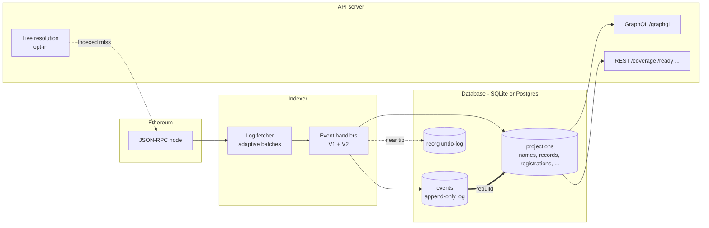
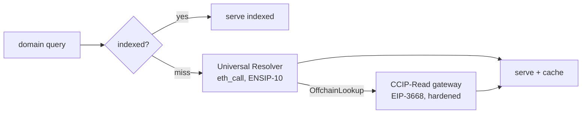

# Architecture

zigens is two processes over one database: an **indexer** that turns chain logs
into an event log plus queryable projections, and an **API server** that reads
them. Either can run alone; the combined Docker deployment runs both.

## The event log is the source of truth

Every handled chain event is stored verbatim in the `events` table before the
handlers update the queryable **projections** (names, resolver records,
registrations, accounts, registries, roles). The projections are a cache of the
log: `ensv2-indexer --backfill` clears and replays them from stored events,
reproducing the live tables byte-for-byte — on either database backend. That
makes corruption recoverable and schema evolution verifiable.

## Reorg safety, in two layers

- **Near the chain tip**, writes are captured into an undo-log with per-block
  lineage (block hash + parent hash). When a stored hash stops matching the
  chain, the indexer walks back to the exact fork point and reverses the
  captured writes.
- **Fail-closed**: if the fork is deeper than the retained lineage, the indexer
  refuses to guess and stops with an explicit error instead of serving wrong
  data. Ranges more than a 1000-block arming window behind the sync target skip
  capture — comfortably past Ethereum finality, so they cannot reorg.

## Dual backend

The storage layer speaks one query abstraction with per-dialect SQL. SQLite is
the zero-dependency default; PostgreSQL (with TLS) suits managed deployments.
CI runs the full suite on SQLite plus the driver, storage, and integration
lanes against a live Postgres, and the Postgres schema is generated from the
SQLite one with a drift gate — the backends cannot diverge silently.

## Query-time resolution (opt-in, default off)

For single-name queries the API can go beyond indexed data, each step gated by
its own flag and degrading to indexed-only on any failure:

Resolved answers are cached pinned to a block hash, so a reorg invalidates them
automatically. Primary names can be forward-verified on-chain (ENSIP-3) the
same way. List queries never trigger live resolution.
