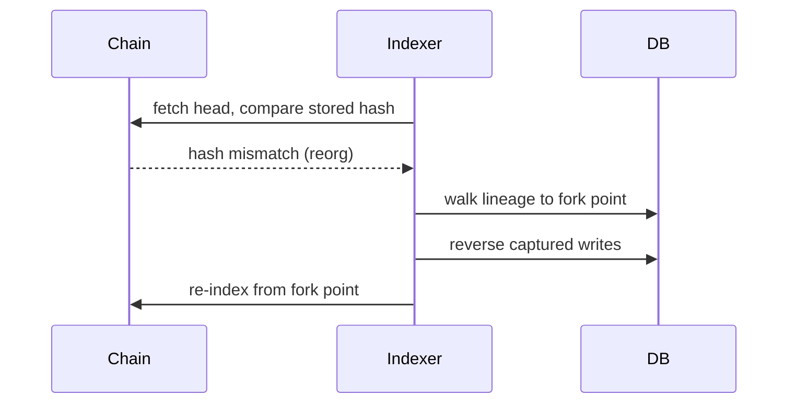

# Operations

## Health model

| Probe | Semantics | Wire it to |
|---|---|---|
| `GET /health` | Process is alive. Never touches the DB — a DB blip must not restart the container. | Container restart policy |
| `GET /ready` | Can serve queries. 503 when the DB is unreachable; lagging behind the chain sets a `stale` flag but stays 200 to avoid rotation flapping. | Load-balancer readiness |
| `GET /coverage` | What this node indexes: chain id, per-protocol head, last-sync time, staleness. | Dashboards, client capability checks |

`GET /metrics` serves Prometheus text: indexed head, safe/finalized positions,
lag, staleness, plus API request counters.

## Shutdown

Both binaries handle `SIGTERM`/`SIGINT`:

- **API**: stops accepting, drains in-flight requests (bounded by the request
  timeout), then exits.
- **Indexer**: finishes the current batch, commits, and exits — sync state is
  always resumable; restart continues exactly where it stopped. During a deep
  catch-up the current batch can take a while; a **second signal forces
  immediate exit** (safe: every batch is one transaction).

## Rebuilding projections

The queryable tables are a cache of the append-only event log. To rebuild them
(after an incident, a bug fix in a handler, or to verify integrity):

```bash
# Stop the live indexer first — the rebuild owns the write lock.
ensv2-indexer --backfill
```

This clears and replays every projection (names, resolver records,
registrations, accounts, registries, roles) from stored events and exits. The
result is byte-identical to what live indexing produced, on SQLite and
PostgreSQL alike.

## Reorgs

Handled automatically: near-tip writes carry an undo-log with per-block
lineage, and a hash mismatch triggers a rollback to the exact fork point, then
re-indexing. If a reorg exceeds the retained lineage the indexer stops with
`ReorgTooDeep` rather than guess — after investigating, restart with
`--from-block <N>` (optionally `--clean`) to reset sync state below the fork.
Ranges well behind the tip (beyond the 1000-block arming window) skip capture.



## Upgrades

1. Pull the new image (or build the new tag).
2. `docker compose up -d` — SIGTERM gives the old containers a clean drain;
   the indexer resumes from committed state.

Schema migrations are applied by the indexer at startup; the API only reads.
Forward-only: no downgrade path is maintained — take a DB snapshot before major
upgrades if you need one.

## Webhook operations

Workers start after the initial sync completes. Deliveries retry with backoff
(`WEBHOOK_MAX_RETRIES`); stuck claims recover automatically after a crash. The
admin UI at `/webhooks` (admin credential — see the API page) lists
registrations and delivery state.
The webhook queue lives in its own SQLite database (`WEBHOOK_DB_PATH`) on
every backend.
